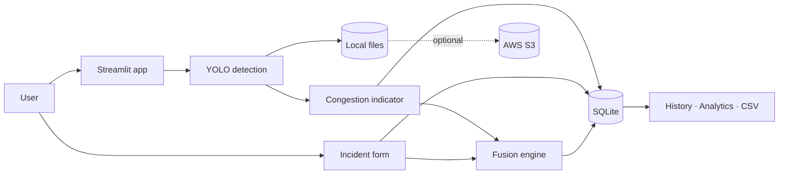

# AI/ML on Cloud Computing: Intelligent Traffic Congestion Monitoring and Incident Prioritization System

A Streamlit web application that detects vehicles in traffic images and videos with a pretrained YOLO model, estimates congestion, records traffic incidents, and combines both signals into an explainable priority with a recommended action. It is built to run locally and on Streamlit Community Cloud, with optional AWS S3 storage and a documented AWS architecture.

## What is real in this project

| Label | Feature |
|---|---|
| **Real AI inference** | Vehicle detection with pretrained Ultralytics YOLOv8n (COCO classes car, motorcycle, bus, truck) |
| **Rule-based** | Congestion indicator (`traffic.py`) and Adaptive Cross-Signal Fusion Engine (`fusion.py`) – deterministic algorithms, **not** trained models |
| **Manual** | Incident reports – the model does **not** detect accidents |
| **Sample data** | Optional generated demo records, always marked `SAMPLE` and hidden by default |
| **Optional cloud** | AWS S3 storage (works only after you configure it) |
| **Proposed only** | AWS Lambda, SageMaker, CloudWatch, managed database (see `docs/architecture.md`) |

## Problem statement

Traffic control rooms receive camera feeds and incident reports separately. Deciding which location needs attention first is manual and slow. This project shows how AI vehicle detection, simple congestion estimation and incident data can be combined into one transparent priority score, using cloud-ready components.

## Objectives

1. Detect and count vehicles in uploaded images/videos using a pretrained deep-learning model.
2. Estimate a congestion indicator from the observed counts.
3. Manage traffic incidents (create, filter, edit, resolve).
4. Fuse congestion and incident signals into an explainable priority and recommended action.
5. Store all results in a database and provide history, analytics and CSV exports.
6. Demonstrate cloud integration (S3) and a realistic AWS architecture.

## Features and modules

| Page | Module(s) | What it does |
|---|---|---|
| Dashboard | `app.py`, `analytics.py` | Totals, congestion & priority distributions, vehicles by class, recent activity, quick navigation |
| Image Detection | `detector.py`, `traffic.py` | Upload JPG/PNG, confidence slider, annotated image with boxes and confidence, counts, congestion gauge, download |
| Video Analysis | `video_processor.py` | Samples N frames from MP4/MOV/AVI/MKV, progress bar, per-frame chart, average and peak counts, annotated sample frames |
| Congestion Analysis | `traffic.py` | Explains the formula, reviews any stored result, shows weighted units, calculator |
| Incidents | `incident_manager.py` | Report, filter (type/severity/status/date), view, edit, resolve; optional admin PIN |
| Priority Engine | `fusion.py` | Combine a detection result and/or incident → score, category, reasons, action; saved with its inputs |
| History | `database.py` | Detections, incidents, priority results, logs; filters, details, CSV, reproducibility check |
| Analytics & Reports | `analytics.py` | Charts by class, category, type/severity, status, priority histogram, daily trend; CSV exports |
| Cloud & Settings | `cloud_storage.py` | S3 status, load/delete sample data, database backup, active configuration |

### Congestion indicator (rule-based)

`vehicle units = cars×1.0 + motorcycles×0.5 + buses×3.0 + trucks×2.5`
`score = min(100, units ÷ 30 × 100)` → Low < 25 ≤ Moderate < 50 ≤ High < 75 ≤ Severe.
This is an **estimated indicator based on observed vehicle counts**, not a validated traffic-density measurement.

### Fusion engine (rule-based decision support)

- Incident component `I = severity points (25/50/75/100) × status factor (Open 1.0, In Progress 0.7, Resolved 0) × recency factor (1.0 → 0.5 over 24 h)`
- `Priority = 0.45 × congestion + 0.55 × I` (if only one signal exists, it is used alone)
- An active Critical incident never scores below 75.
- Low < 30 ≤ Medium < 55 ≤ High < 75 ≤ Critical.
- Vehicle count is not added separately because the congestion score already comes from it (no double counting).
All weights and thresholds are configurable in `.env`.

## Technology stack

Python · Streamlit · Ultralytics YOLO (PyTorch, CPU) · OpenCV · Pillow · Pandas · NumPy · Plotly · SQLite · boto3 (AWS S3) · pytest · Git/GitHub · Streamlit Community Cloud

## Architecture



Full explanation, implemented-vs-proposed table and the proposed AWS production design: [`docs/architecture.md`](docs/architecture.md).

## Folder structure

```
AI-ML-Cloud-Traffic-Demo/
├── app.py                    # Streamlit UI (all pages)
├── config.py                 # Settings from environment / .env
├── detector.py               # YOLO vehicle detection + image validation
├── video_processor.py        # Frame-sampled video analysis
├── traffic.py                # Congestion indicator
├── fusion.py                 # Adaptive Cross-Signal Fusion Engine
├── incident_manager.py       # Incident validation and rules
├── database.py               # SQLite data layer
├── analytics.py              # DataFrames, charts, CSV, sample data
├── cloud_storage.py          # Optional S3 with local fallback
├── manual_inference_test.py  # Real YOLO check from the command line
├── requirements.txt          # Runtime packages
├── requirements-dev.txt      # + pytest
├── packages.txt              # System libraries for Streamlit Cloud
├── pytest.ini
├── .env.example
├── .gitignore
├── .streamlit/
│   ├── config.toml
│   └── secrets.toml.example
├── tests/                    # 104 automated tests
├── data/
│   ├── sample_images/        # put your own test images here
│   └── uploads/              # saved uploads (git-ignored)
├── models/                   # YOLO weights download here (git-ignored)
├── outputs/                  # annotated images (git-ignored)
└── docs/
    ├── architecture.md
    └── deployment.md
```

Changes from the suggested structure: added `manual_inference_test.py` (real model check), `requirements-dev.txt` (keeps pytest off the server), `packages.txt` (needed by OpenCV on Streamlit Cloud), `models/` (weights location) and `tests/test_detector.py` + `tests/test_video_and_storage.py`. The modules stay flat (no package folder) to keep imports simple for beginners.

## Installation (Windows PowerShell)

Requirements: **Python 3.11 or 3.12** (recommended) and Git. Check with:

```powershell
python --version
git --version
```

Then, inside the project folder:

```powershell
# 1. Create and activate a virtual environment
python -m venv .venv
.\.venv\Scripts\Activate.ps1
# If activation is blocked, run once:  Set-ExecutionPolicy -Scope CurrentUser RemoteSigned

# 2. Install packages (this downloads PyTorch CPU; can take several minutes)
python -m pip install --upgrade pip
pip install -r requirements-dev.txt

# 3. Optional: create your own settings file
Copy-Item .env.example .env
```

In VS Code: **Ctrl+Shift+P → Python: Select Interpreter →** choose `.venv`.

## How to run the app

```powershell
streamlit run app.py
```

The browser opens at <http://localhost:8501>. The first detection downloads the YOLO weights (~6 MB) into `models/`.

## How to run tests

```powershell
python -m compileall -q .
python -m pytest -q
python manual_inference_test.py        # real YOLO inference on a bundled example image
python manual_inference_test.py data\sample_images\your_image.jpg
```

Automated tests use a fake YOLO model (no download needed). `manual_inference_test.py` runs the real model.

## Optional AWS S3 setup

The app works fully without AWS. To store uploads and annotated images in S3:

1. AWS Console → **S3 → Create bucket** (e.g. `traffic-demo-<yourname>`), region `ap-south-1`, keep **Block all public access** ON.
2. **IAM → Users → Create user** (e.g. `traffic-demo-app`) → attach this least-privilege inline policy (replace the bucket name):

```json
{
  "Version": "2012-10-17",
  "Statement": [
    { "Effect": "Allow", "Action": ["s3:ListBucket"], "Resource": "arn:aws:s3:::YOUR-BUCKET" },
    { "Effect": "Allow", "Action": ["s3:PutObject", "s3:GetObject"],
      "Resource": "arn:aws:s3:::YOUR-BUCKET/traffic-demo/*" }
  ]
}
```

3. Create an **access key** for that user (use case: application outside AWS).
4. Put the values in `.env` (local) or Streamlit secrets (hosted):

```
USE_S3=true
S3_BUCKET=YOUR-BUCKET
AWS_DEFAULT_REGION=ap-south-1
AWS_ACCESS_KEY_ID=...
AWS_SECRET_ACCESS_KEY=...
```

5. Restart the app → **Cloud & Settings → Check storage status**.
If S3 fails (wrong key, no permission, offline) the app saves files locally and shows a warning. Never commit keys.

## Git and GitHub

Create an **empty** repository on GitHub first (no README), then:

```powershell
# 1. Initialise
git init
git branch -M main

# 2. Stage and CHECK what will be committed
git add .
git status
git diff --cached --name-only
# Make sure you do NOT see: .env, secrets.toml, *.db, *.pt, .venv
git diff --cached --name-only | Select-String -Pattern "\.env$|secrets\.toml$|\.db$|\.pt$"
# (no output = good)

# Check for large files (> 5 MB)
git diff --cached --name-only | ForEach-Object { Get-Item $_ } | Where-Object Length -gt 5MB

# 3. First commit
git commit -m "Initial commit: traffic congestion monitoring and incident prioritization"

# 4. Connect to GitHub (replace the placeholders)
git remote add origin https://github.com/<your-username>/<your-repo-name>.git

# 5. Push
git push -u origin main
```

GitHub asks you to sign in the first time (browser login or a personal access token).

Updating after future changes:

```powershell
git status
git add .
git diff --cached --name-only     # check again for secrets
git commit -m "Describe what you changed"
git push
```

## Deployment (Streamlit Community Cloud)

Short version: push to GitHub → <https://share.streamlit.io> → Create app → choose repo, branch `main`, file `app.py` → Advanced settings: Python 3.12 → Deploy → check logs → run the smoke test.
Full guide, smoke-test checklist and troubleshooting: [`docs/deployment.md`](docs/deployment.md).

## Database backup

- In the app: **Cloud & Settings → Create backup** (also offers a download).
- Manually: stop the app, then `Copy-Item data\traffic.db data\traffic_backup.db`.

## Screenshots

_Add screenshots after running the app:_

| Dashboard | Image detection | Priority engine |
|---|---|---|
| `docs/screenshots/dashboard.png` | `docs/screenshots/detection.png` | `docs/screenshots/priority.png` |

## Limitations

- The congestion score is an estimate from vehicle counts in one view; it does not measure speed, queue length or road capacity and is not calibrated per camera.
- YOLOv8n is the smallest model: fast on CPU but can miss small, distant or occluded vehicles. No accuracy figures are claimed for this dataset.
- Video analysis samples frames and has no tracking, so the same vehicle is counted in each frame where it appears.
- Incidents are entered manually; there is no automatic accident detection.
- The fusion engine is rule-based with hand-chosen weights; it is not trained or validated on real traffic-control decisions.
- SQLite and local files are fine for a demo but are temporary on Streamlit Community Cloud.
- The optional admin PIN is a shared secret, not user authentication.
- Ultralytics YOLO is licensed under AGPL-3.0; check the licence before any commercial use.

## Future enhancements

- Object tracking (e.g. ByteTrack) to count unique vehicles and estimate flow and speed.
- Per-camera calibration (lane count, region of interest) for a better congestion measure.
- A trained and evaluated accident-detection model.
- Amazon RDS / DynamoDB instead of SQLite; S3 event → Lambda → SageMaker pipeline; CloudWatch dashboards and alarms.
- Real user authentication and roles.
- Live camera streams (RTSP) and map view of locations.

## Team / member details

| Name | Registration number | Role |
|---|---|---|
| _Your name_ | _Your reg. no._ | _Role_ |
| _Member 2_ | _Reg. no._ | _Role_ |

Guide: _Faculty name_ · Course: _Course name_ · Institution: _Institution name_
