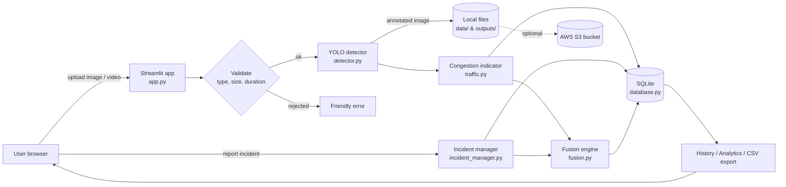
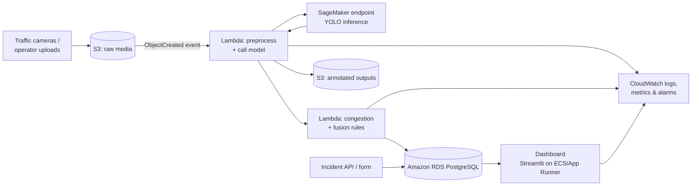

# Architecture

## 1. What is implemented vs. proposed

| Component | Status | Notes |
|---|---|---|
| Streamlit web interface (`app.py`) | **Implemented** | 9 pages, runs locally and on Streamlit Community Cloud |
| YOLO vehicle detection (`detector.py`) | **Implemented – real AI inference** | Pretrained Ultralytics YOLOv8n (COCO); classes car, motorcycle, bus, truck |
| Video frame sampling (`video_processor.py`) | **Implemented** | Evenly sampled frames, no tracking |
| Congestion indicator (`traffic.py`) | **Implemented – rule-based** | Estimate from observed counts, not a calibrated density measurement |
| Incident management (`incident_manager.py`) | **Implemented – manual reports** | No automatic accident detection |
| Fusion engine (`fusion.py`) | **Implemented – rule-based decision support** | Deterministic, not a trained ML model |
| SQLite database (`database.py`) | **Implemented (local demo)** | Not a managed cloud database |
| AWS S3 storage (`cloud_storage.py`) | **Implemented, optional** | Works only when you configure a bucket and credentials |
| AWS Lambda | **Proposed extension** | Not implemented |
| Amazon SageMaker endpoint | **Proposed extension** | Not implemented |
| Amazon CloudWatch | **Proposed extension** | App currently logs to console + `processing_logs` table |
| Managed database (Amazon RDS PostgreSQL / DynamoDB) | **Proposed extension** | Replaces SQLite in production |

## 2. Current (implemented) data flow



Text version (if Mermaid does not render):

```
Browser -> Streamlit app -> validation -> YOLO detection -> congestion score --+
                                                                                +--> Fusion engine -> priority + action
Browser -> incident form -> validation -> incident record ---------------------+
All results -> SQLite (metadata) ; images -> local disk (and optionally S3)
SQLite -> history, analytics, CSV exports -> browser
```

## 3. Step-by-step flow

1. **Upload** – the user uploads a JPG/PNG image or a short video in Streamlit.
2. **Validation** – extension, file size, image decoding (and video duration) are checked. Large images are shrunk to at most 1920 px.
3. **Detection** – the pretrained YOLO model runs on the image (or each sampled video frame). Only vehicle classes are kept.
4. **Congestion** – counts are converted to weighted vehicle units and scaled to a 0–100 indicator with a category.
5. **Persistence** – the session, per-class counts and file paths are written to SQLite in one transaction. Image files are saved to disk and, if enabled, uploaded to S3.
6. **Incidents** – operators record incidents manually; they are validated and stored.
7. **Fusion** – the user picks a detection result and/or an incident; the engine produces a priority score, category, explanation and recommended action. The exact inputs (including the time used for recency) are stored so the result can be reproduced.
8. **Reporting** – dashboard, history, analytics and CSV exports read from the database.

## 4. Proposed production architecture on AWS (NOT implemented)



- **S3** stores raw and annotated media; an upload event triggers processing.
- **Lambda** handles event-driven preprocessing and the (lightweight) congestion and fusion rules – the same `traffic.py` and `fusion.py` code can be reused.
- **SageMaker** hosts the YOLO model as a managed inference endpoint, so the web tier stays light.
- **Amazon RDS (PostgreSQL)** replaces SQLite for durable, multi-user storage.
- **CloudWatch** collects logs, metrics (inference latency, error counts) and alarms (e.g. many Critical priorities).
- **IAM** least-privilege roles connect the services; secrets live in AWS Secrets Manager.

## 5. Database schema

| Table | Purpose | Key columns |
|---|---|---|
| `detection_sessions` | One row per image/video analysis | `id` PK, `created_at`, `source_type`, file paths, `total_vehicles`, `congestion_score`, `congestion_category`, `is_sample` |
| `vehicle_counts` | Per-class counts | `session_id` FK → `detection_sessions.id` (ON DELETE CASCADE), `vehicle_class`, `count` |
| `incidents` | Manually reported incidents | `id` PK, type, location, severity, status, timestamps, `is_sample` |
| `fusion_results` | Priority assessments | `session_id` FK, `incident_id` FK, `inputs_json`, score, category, explanation, action |
| `processing_logs` | Basic audit / error log | level, event, details |

For videos, `total_vehicles` stores the **peak** number of vehicles visible in one sampled frame, and `vehicle_counts` stores **average** per-frame counts.
